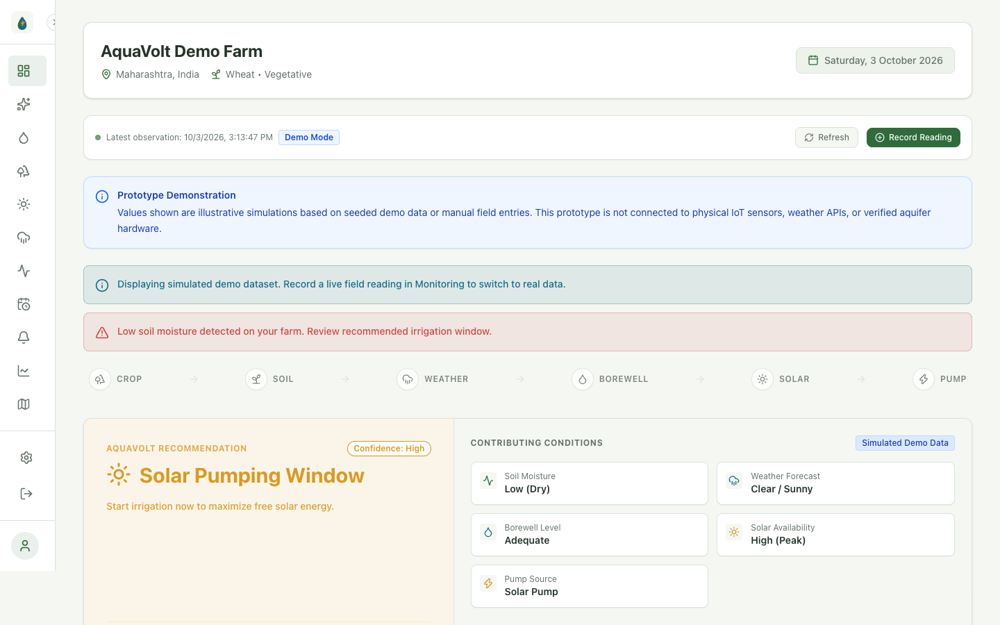
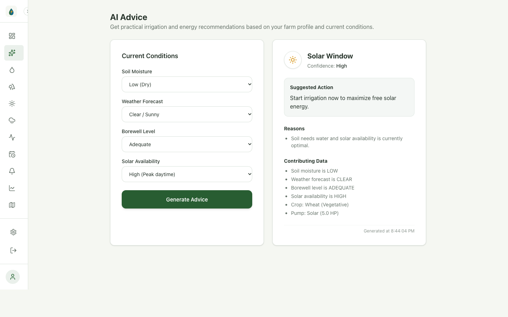
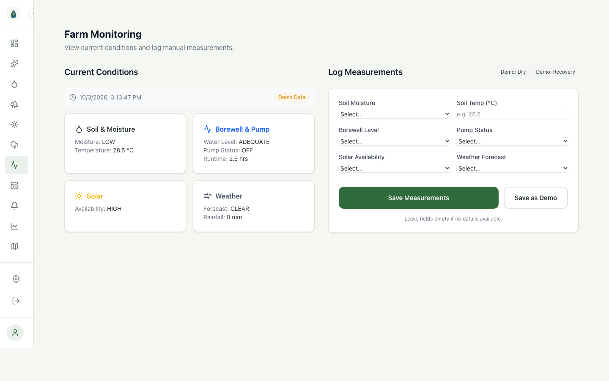
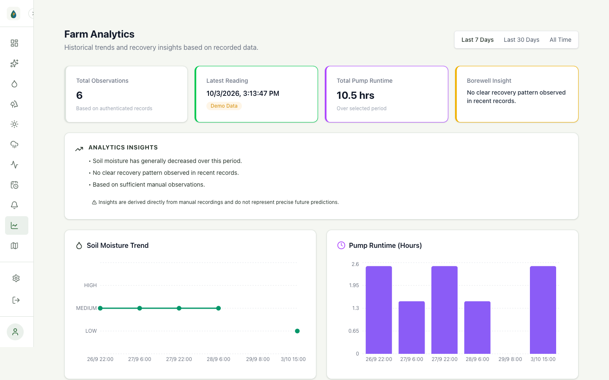

# AquaVolt AI 🌾⚡💧

> **Explainable Water & Energy Decision Support for Sustainable Agriculture**  
> *Smart Water. Smart Energy. Sustainable Farming.*

[](https://react.dev/)
[-009688.svg)](https://fastapi.tiangolo.com/)
[](https://sqlite.org/)
[](https://tailwindcss.com/)
[](LICENSE)
[](#)

---

## 📌 Overview

**AquaVolt AI** is an explainable agricultural decision-support platform designed to help farmers decide **WHEN** and **HOW** to irrigate by synthesizing multiple agricultural, subterranean, and meteorological variables into one practical recommendation.

Rather than operating as a hazardous black-box pump switch, AquaVolt AI keeps the **farmer in control** by providing transparent **WHAT**, **WHY**, and **WHEN** directives that balance crop hydration needs, solar generation availability, and subterranean aquifer recovery.

---

## 🌾 The Problem & The Gap

Farmers today do not have one simple variable; they navigate a complex web of disconnected factors:
* 🌱 **Crop Stage & Transpiration:** Dynamic water demand based on crop growth.
* 🪴 **Soil Moisture:** Real-time root-zone saturation deficits.
* ☁️ **Weather & Precipitation:** Upcoming rainfall likelihood.
* 🕳️ **Borewell Dynamics:** Subterranean water column depth, drawdown rates, and recovery intervals.
* ⚙️ **Pump Mechanics:** Horsepower rating, energy source, and dry-run cavitation risks.
* ☀️ **Solar Availability:** Free daytime photovoltaic power vs. costly grid/diesel power.

### Why Traditional Irrigation Logic Fails
* **Fixed Timers:** Pumps run on static 2–3 hour schedules regardless of rainfall or soil saturation.
* **Soil-Only Sensors:** Sensors detect dry soil but ignore whether the borewell has sufficient water to pump safely.
* **Solar-Only Pumping:** Solar pumps run continuously during sunlight hours even when fields are waterlogged, depleting aquifers.
* **Aquifer Neglect:** Running pumps on depleted aquifers causes severe motor burnouts and long-term groundwater depletion.

---

## 💡 The AquaVolt AI Solution

AquaVolt AI unifies these signals through an explainable multi-condition decision pipeline:

```
[ Farm Profile ] + [ Soil Moisture ] + [ Borewell State ] + [ Weather Context ] + [ Solar Output ]
                                            │
                                            ▼
                         ┌───────────────────────────────────────┐
                         │   AQUAVOLT DETERMINISTIC ENGINE       │
                         │   (Multi-Condition Safety Rules)      │
                         └───────────────────────────────────────┘
                                            │
                                            ▼
                         ┌───────────────────────────────────────┐
                         │         EXPLAINABLE ADVICE            │
                         │  • WHAT: Concrete Action Directive    │
                         │  • WHY:  Transparent Factors          │
                         │  • WHEN: Optimal Timing Window        │
                         └───────────────────────────────────────┘
                                            │
                                            ▼
                               [ Farmer in Control ]
```

---

## 🚀 Key Implemented Modules

| Module | Status | Description |
| :--- | :---: | :--- |
| **Authentication & Profile Isolation** | 🟢 Live | Secure phone/password login, JWT tokens, bcrypt password hashing, and user-isolated farm records. |
| **Farm Onboarding Wizard** | 🟢 Live | Multi-step configuration capturing crop type, acreage, borewell depth, pump HP, and solar pump integration. |
| **Executive Dashboard** | 🟢 Live | Real-time farm telemetry hub with live recommendation banner, alert logs, and system health status. |
| **Field Telemetry Logging** | 🟢 Live | Manual field observation entry and persistent SQLite history tracking soil, borewell, weather, and solar inputs. |
| **Explainable Advice Engine** | 🟢 Live | Deterministic, multi-condition decision rules evaluating safety overrides, weather delays, and solar synchronization. |
| **Historical Analytics** | 🟢 Live | Interactive Recharts visualizations across 7-day, 30-day, and all-time observation periods. |
| **Multilingual Foundation** | 🟢 Live | Instant localization supporting English (`en`), Marathi (`mr`), and Hindi (`hi`). |
| **Demo Telemetry Seeder** | 🟢 Live | Pre-seeded accounts and realistic simulation datasets for immediate evaluation. |

---

## 🧠 Core Decision Engine Logic

The current advice engine is a **deterministic, explainable rule engine** (verified by automated regression tests in [`test_advice_engine.py`](file:///Users/siddheshthorat/Documents/aquavolt_ai/test_advice_engine.py)):

1. **`INSUFFICIENT_DATA`**: Triggers when critical soil moisture or solar availability metrics are missing.
2. **`RAIN_DELAY`**: Postpones irrigation when rain is expected, preventing water waste and power consumption.
3. **`WAIT_BEFORE_IRRIGATING`**: Prevents over-irrigation when soil moisture is already adequate or optimal.
4. **`BOREWELL_RECOVERY`**: Critical safety override when subterranean water level is low, protecting pump motors from dry-run burnouts.
5. **`SOLAR_WINDOW`** *(Critical regression-tested scenario)*:
   * **Conditions:** Low Soil Moisture + High Solar Irradiance + Solar Pump (`YES`) + Adequate Borewell + Clear Weather.
   * **Action:** Recommends immediate daytime pumping to maximize zero-marginal-cost solar power without grid/battery strain.
6. **`IRRIGATION_MAY_BE_NEEDED`**: Prompts irrigation when soil moisture is low on grid/diesel systems.

---

## 📸 Real Application Screenshots

All screenshots below represent the **actual running application** captured directly via Google Chrome (`http://localhost:5173`):

| Dashboard Overview | Advice Engine (Solar Window) |
| :---: | :---: |
|  |  |
| *Executive farm context, active decision cards & live alerts* | *Regression-tested SOLAR_WINDOW decision with WHAT, WHY, WHEN* |

| Field Telemetry Logging | Historical Analytics |
| :---: | :---: |
|  |  |
| *Manual field observation logging & telemetry status* | *Interactive Recharts trends (7d / 30d / All-Time)* |

*Full screenshot inventory and presentation guide available in [`docs/screenshots/README.md`](docs/screenshots/README.md).*

---

## 🛠️ Technology Stack

### Frontend
* **Core:** React 18, TypeScript, Vite
* **Styling:** Tailwind CSS, Custom Eco Design System (`#1F4D2B`, `#2F6B3B`, `#176B87`, `#D99A22`)
* **Visualization:** Recharts
* **Icons:** Lucide React
* **Routing:** React Router v6

### Backend
* **API Framework:** Python 3.9+, FastAPI, Uvicorn
* **Database & ORM:** SQLite (`data/aquavolt.db`), SQLAlchemy
* **Authentication:** OAuth2 Password Bearer, PyJWT, Passlib (Bcrypt)
* **Validation:** Pydantic v2

---

## 📦 Getting Started

### Prerequisites
* **Node.js** (v18.0.0 or higher) & **npm**
* **Python** (v3.9 or higher)

### 1. Clone the Repository
```bash
git clone https://github.com/harshad-bgt/aquavolt_ai.git
cd aquavolt_ai
```

### 2. Backend Setup
```bash
# Create and activate virtual environment
python3 -m venv venv
source venv/bin/activate  # On Windows: venv\Scripts\activate

# Install dependencies
pip install -r backend/requirements.txt

# Start FastAPI server
uvicorn backend.main:app --reload --host 0.0.0.0 --port 8000
```
Backend API will be accessible at `http://localhost:8000` (Interactive API docs at `http://localhost:8000/docs`).

### 3. Frontend Setup
```bash
# In a new terminal tab:
npm install

# Start Vite development server
npm run dev
```
Frontend will be accessible at `http://localhost:5173`.

---

## 🔑 Demo Account Credentials

A pre-seeded demonstration account is available for instant evaluation:
* **Mobile / Identifier:** `9999999999`
* **Password:** `password`

---

## 🧪 Running Automated Tests

Run the full automated pytest suite to verify the Advice Engine rules, Monitoring persistence, and Solar Pump case-normalization:
```bash
source venv/bin/activate
pytest test_advice_engine.py test_monitoring.py test_persistence.py -v
```

---

## 🗺️ Product Roadmap

### 🟢 CURRENT (Implemented MVP)
* Full React + Vite web platform & responsive layout
* Secure JWT authentication & user-isolated farm profiles
* Multi-step farm onboarding & profile management
* Field monitoring records with persistent SQLite storage
* Deterministic Advice Engine (`SOLAR_WINDOW`, `RAIN_DELAY`, `BOREWELL_RECOVERY`)
* Live Executive Dashboard with alerts and activity log
* Interactive Recharts Analytics (7-day, 30-day, all-time views)
* Multilingual foundation (English, Marathi, Hindi)
* Pre-seeded demo dataset and comprehensive test suite

### 🟡 NEXT (Near-Term Phase)
* Live Weather API synchronization (Doppler precipitation radar)
* LoRaWAN IoT sensor hardware gateway integration
* Solar panel inverter telemetry ingestion
* Automated SMS & WhatsApp alert notifications
* Expanded regional language coverage (Gujarati, Kannada, Telugu)
* Basic borewell recharge recovery timer calculations

### 🔵 FUTURE (Long-Term Vision)
* Predictive ML irrigation demand models
* Dynamic aquifer drawdown modeling per individual borewell
* Mathematical water-energy co-optimization balancing tariffs & yields
* Automated pump relay controllers with physical manual safety overrides
* Multi-farm FPO regional water governance analytics

---

## 📑 Hackathon Presentation

The official competition pitch deck is included directly in the root directory:
* **Pitch Deck:** [`AquaVolt_AI_Final_Hackathon_Pitch_Deck.pptx`](AquaVolt_AI_Final_Hackathon_Pitch_Deck.pptx) (13 slides, self-contained embedded high-resolution graphics and live screenshots).

---

## ⚠️ Prototype Transparency Disclosure

AquaVolt AI currently utilizes seeded and manually logged telemetry for prototype demonstration and algorithm validation. It is not currently connected to live physical IoT sensors or automated pump relays in the field. All borewell drawdown curves and sensor schematics presented in concept documentation represent illustrative engineering targets.

---

## 📄 License

This project is licensed under the MIT License — see the [LICENSE](LICENSE) file for details.
